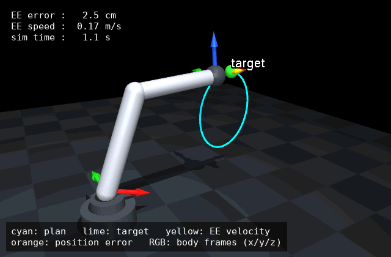
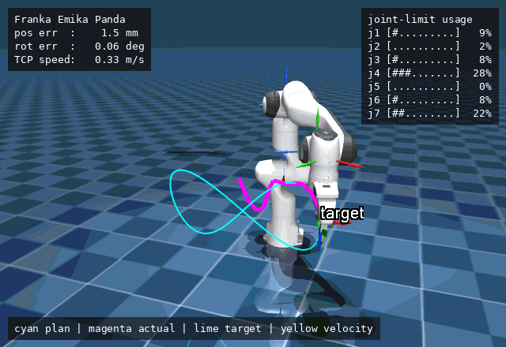
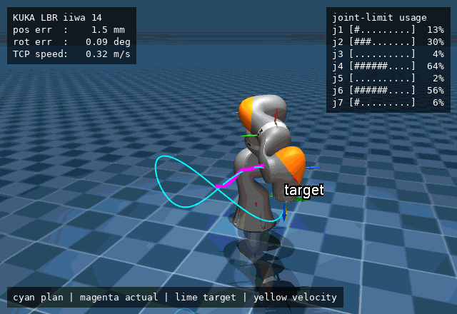

# mujoco-debugdraw

**Draw targets, coordinate frames, force vectors, paths and labels in the MuJoCo Python viewer without editing MJCF or writing OpenGL.**



*Everything except the arm is drawn by `mujoco-debugdraw` at runtime. The model XML contains no debug geometry. ([`examples/reaching_debug.py`](examples/reaching_debug.py))*

### On real robot models: Franka Panda and KUKA LBR iiwa 14

| Franka Emika Panda | KUKA LBR iiwa 14 |
|---|---|
|  |  |

[`examples/manipulator_demo.py`](examples/manipulator_demo.py) drives either 7-DoF arm along a figure-eight with damped-least-squares differential IK. The robot XML is loaded unmodified from [MuJoCo Menagerie](https://github.com/google-deepmind/mujoco_menagerie). The demo draws:

- the plan (cyan) inside a faint workspace box (`box`), and the actual TCP trail (magenta)
- the target point, plus its desired orientation as faint axes (`frame_at`)
- the actual TCP frame, every joint's axis (`joint_axis`, labelled when near a limit) and the arm's center of mass (`body_com`)
- the TCP velocity
- contact forces on a spring-loaded bumper that the gripper brushes once per lap (`contacts`), plus contact marks that expire on their own (`ttl_frames`)
- a HUD with position/orientation error and **joint-limit usage per joint**

The loop never calls `clear()`: the plan and box are drawn once and everything else is keyed.

```bash
python examples/manipulator_demo.py                # Franka Panda
python examples/manipulator_demo.py --robot iiwa   # KUKA LBR iiwa 14
python examples/manipulator_demo.py --no-bumper    # free space, no contacts
```

The bumper is added at load time with `MjSpec` (MuJoCo ≥ 3.3); the robot XML itself is not edited.

The robot models are not redistributed here. On first run the script fetches them from Menagerie (Apache-2.0, ~55 MB), or it uses `MUJOCO_MENAGERIE_PATH` if you already have a checkout.

## Install

```bash
pip install git+https://github.com/harshalbhat/mujoco-debugdraw
```

Once the package is on PyPI, this becomes `pip install mujoco-debugdraw`. The only dependencies are `mujoco` and `numpy`. It needs no ROS, Docker, CUDA, or browser.

## Quickstart

```python
import mujoco
import mujoco.viewer
from mujoco_debugdraw import DebugDraw

model = mujoco.MjModel.from_xml_path("examples/scene.xml")
data = mujoco.MjData(model)
target = [0.45, 0.00, 0.30]

with mujoco.viewer.launch_passive(model, data) as viewer:
    draw = DebugDraw(model, data, viewer)

    while viewer.is_running():
        mujoco.mj_step(model, data)

        draw.clear()
        draw.frame("end_effector", scale=0.12, label="EE")
        draw.point(target, color="lime", size=0.025, label="target")
        draw.line([[0.20, -0.20, 0.05], [0.30, -0.10, 0.10], target], color="cyan")
        draw.arrow(data.site_xpos[0], [0.0, 0.0, 0.10], color="yellow", label="v_des")
        draw.text("MuJoCo DebugDraw active", position="top_left")

        draw.sync()    # always BEFORE viewer.sync()
        viewer.sync()
```

On macOS, launch passive-viewer scripts with `mjpython` instead of `python`. This is a MuJoCo requirement, not specific to this package.

## API

| Call | Draws | Notes |
|---|---|---|
| `DebugDraw(model, data, viewer, max_geoms=500)` | — | `viewer` is the `launch_passive()` handle. A `mujoco.Renderer` or `MjvScene` also works (see below). |
| `point(position, color="red", size=0.02, label=None)` | Sphere | `size` is the radius in meters. |
| `line(points, color="cyan", width=2.0)` | Polyline, one segment per consecutive pair | `points` has shape `(N, 3)` with N ≥ 2. `width` is in **pixels**. |
| `arrow(origin, vector, color="yellow", scale=1.0, width=0.01, label=None)` | Shaft + head from `origin` to `origin + scale * vector` | `width` is the shaft radius in meters. **A zero-length arrow draws nothing** and does not raise. |
| `frame(target, scale=0.10, label=None, kind=None, width=None)` | X/Y/Z axes in red/green/blue | `target` is a body or site name, or a body ID. If a name is both a body and a site, the body wins. Use `kind="site"` to force a site, or with an int to mean a site ID. |
| `frame_at(position, rotation, scale=0.10, width=None, alpha=1.0, label=None)` | X/Y/Z axes at any world pose | Same axes as `frame()`, from a raw position and [rotation](#rotations). `alpha` in `(0, 1]` fades all three, e.g. for a desired orientation. |
| `box(center, half_size, rotation=None, color="orange", label=None)` | Solid oriented box | `half_size` is the half-extents in meters (like MuJoCo). `rotation=None` is world-aligned. Give `color` an alpha below 1 to see through it. |
| `body_com(body, subtree=False, color="white", size=0.02, label=None)` | Sphere at a center of mass | `subtree=False`: that body alone (`data.xipos`). `subtree=True`: the body and its descendants (`data.subtree_com`). `body_com(0, subtree=True)` is the whole model's COM. |
| `joint_axis(joint, scale=0.10, color="orange", width=0.005, label=None)` | Arrow along a joint axis | Hinge and slide joints, from `data.xanchor` along `data.xaxis`. Ball and free joints raise `ValueError`. |
| `contacts(body=None, normals=True, forces=True, normal_scale=0.05, force_scale=0.01, normal_color="red", force_color="yellow", width=0.003)` | Normal and force arrow per active contact | `force_scale` is meters per newton. See [Contacts](#contacts). |
| `text(message, position="top_left")` | Screen-corner HUD | `top_left`, `top_right`, `bottom_left`, `bottom_right`. Messages in the same corner stack. |
| `clear()` | — | Drops every queued primitive, keyed or not. |
| `remove(key)` | — | Drops one keyed primitive. Returns `True` if something was removed. Never raises. |
| `sync()` | — | Writes the queue into the scene. Call it before `viewer.sync()`. |

Every drawing method also takes `key=None` and `ttl_frames=None` (see [Keys and lifetime](#keys-and-lifetime)).

**Colors:** `red green blue yellow cyan magenta white black gray orange lime`, `"#RRGGBB"`, `"#RRGGBBAA"`, `[r, g, b]` or `[r, g, b, a]` with values in `[0, 1]`. Out-of-range values raise `InvalidColorError` rather than being silently clamped.

**Errors:** bad shapes, non-finite numbers, and non-positive sizes raise `ValueError` with a message that names the argument. An unknown body, site or joint name raises `UnknownTargetError` and suggests close matches (`No body or site named 'end_efector'. Did you mean: end_effector?`).

### Rotations

`frame_at()` and `box()` take `rotation` as a `(3, 3)` matrix whose **columns** are the local X/Y/Z axes in world coordinates, the same as `data.xmat[i].reshape(3, 3)`. A flat `(9,)` array is read row-major, so `data.xmat[i]` can be passed as is. The matrix must be a proper rotation: a non-orthonormal matrix or a reflection raises `ValueError`.

For a body, `frame_at(data.xpos[i], data.xmat[i])` draws exactly what `frame(i)` draws.

### Keys and lifetime

Primitives stay queued until you remove them, so you can either redraw everything after a `clear()` each frame (as in the quickstart) or skip `clear()` and manage lifetimes per primitive:

- **`key="goal"`** replaces any primitive already queued under that key, so a keyed call can run every frame without piling up.
- **`ttl_frames=N`** removes the primitive automatically after it has been written by `N` calls to `sync()`. A frame is one `sync()`, not a span of time. Redrawing with the same key restarts the count.
- **`remove(key)`** drops one keyed primitive. `clear()` still drops everything, whatever TTL is left.

```python
draw.line(plan, color="cyan", key="plan")              # drawn once, stays

while viewer.is_running():
    mujoco.mj_step(model, data)
    draw.frame("end_effector", key="ee")               # keyed: replaced each frame
    draw.contacts(ttl_frames=1)                        # unkeyed: expires after one sync
    draw.sync()
    viewer.sync()
```

Unkeyed primitives without `ttl_frames` are never removed unless you call `clear()`. In a loop that skips `clear()`, they pile up until `max_geoms` is reached, and then new ones are dropped with a `CapacityWarning`.

### Contacts

`contacts()` draws, for each active contact in `data.contact[:data.ncon]`, a normal arrow of length `normal_scale` and a force arrow of `force_scale` meters per newton, both starting at the contact point. Only the linear force from `mj_contactForce` is drawn (not the torque). Contacts that are not in the solver get a normal but no force.

- With `body=None`, every arrow shows the force acting on the contact's second geom (`geom[1]`). The normal points from `geom[0]` to `geom[1]`.
- With `body="name"`, only contacts that touch that body are drawn, and each arrow is flipped as needed to show the force acting **on that body**. Summed over its contacts, the forces on a box resting on the floor equal its weight.
- All arrows from one call are one primitive (up to 2 geoms per contact), so `key` and `ttl_frames` apply to the whole set. With the default `max_geoms=500` that is about 250 contacts.

`contact.frame` stores the contact axes in its **rows**, while `frame_at()` takes them as columns. To draw a full contact frame, transpose it:

```python
c = data.contact[i]
draw.frame_at(c.pos, c.frame.reshape(3, 3).T, scale=0.03)
```

[`examples/contact_forces.py`](examples/contact_forces.py) shows all of this on two stacked boxes.

**Compared with the viewer's built-in flags.** MuJoCo's viewer can already show contact points, contact forces, COMs and joints for the whole model (`mjVIS_CONTACTPOINT`, `mjVIS_CONTACTFORCE`, `mjVIS_COM`, `mjVIS_JOINT`, toggled in the left panel). Those flags are all-or-nothing and use fixed colors. `contacts()`, `body_com()` and `joint_axis()` are for targeted debugging: one body's contacts, one joint, or one COM, with your own color, label, scale and lifetime.

## How it works (and what it doesn't touch)

- Primitives become **visual-only geoms in `viewer.user_scn`**, written under `viewer.lock()` with the public `mjv_initGeom` / `mjv_connector` functions. They have no mass and no collision, and they never enter `MjModel`.
- `model` and `data` are only **read**. The test suite steps a model 300 times with and without drawing and asserts bit-identical `qpos`, `qvel`, and contact count.
- Each `sync()` rewrites DebugDraw's slice of `user_scn` from scratch, so geometry never accumulates. Any geoms you put in `user_scn` yourself *before* the first `sync()` are preserved.
- Anything read from `data` (frames, COMs, joint axes, contacts) is sampled when you call the method, so call it after `mj_step` / `mj_forward`. `sync()` does not re-read `data`.

### Offscreen rendering (videos, CI, notebooks)

Pass a `mujoco.Renderer` instead of a viewer. Call `draw.sync()` **after** `renderer.update_scene()` and before `renderer.render()`:

```python
renderer = mujoco.Renderer(model, 480, 640)
draw = DebugDraw(model, data, renderer)
...
renderer.update_scene(data, camera=cam)
draw.sync()
pixels = renderer.render()
```

The Renderer has no text overlay, so `draw.text()` is not drawn in this mode. The queued messages are available as `draw.texts` (grouped by corner) if you want to composite them yourself. [`examples/record_demo.py`](examples/record_demo.py) does this with Pillow to produce the GIF above.

## Why this exists

Debugging a controller usually means answering questions like: *is my target where I think it is? Is this frame rotated the way I assumed? Which way is that force pointing?* In the MuJoCo Python viewer, getting those answers on screen has meant one of three things:

- adding throwaway `site`/`geom` elements to the MJCF
- hand-filling `mjvGeom` structs in `user_scn`
- printing numbers

People keep asking for an easier way to add custom geoms and frames to the passive viewer ([google-deepmind/mujoco#1023](https://github.com/google-deepmind/mujoco/issues/1023)). This package is a small, tested wrapper around the supported path. It is not a new viewer, simulator, or UI framework.

## Contributing

```bash
git clone https://github.com/harshalbhat/mujoco-debugdraw && cd mujoco-debugdraw
pip install -e ".[dev]"
pytest                                   # unit + scene tests, no display needed
MUJOCO_GL=egl pytest                     # also runs the offscreen pixel tests
xvfb-run -a pytest                       # also runs the real passive-viewer test (Linux)
python examples/reaching_debug.py        # interactive demo
```

## License

MIT
